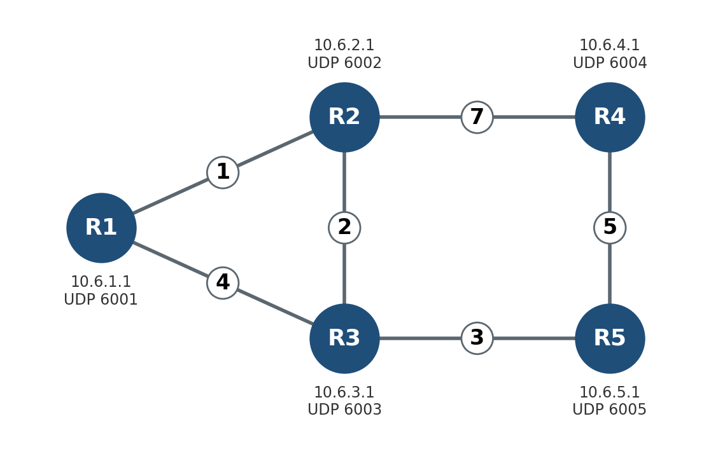

# Resultados dos experimentos

*Arquivo gerado por `gera_resultados.py` a partir das medições em `evidencias/`. Não editar à mão.*

Como foi medido: 5 processos reais do roteador (topologia `local5`, `configs/local5`) numa só máquina, em `127.0.0.1`, portas 6001 a 6005, como o enunciado permite. Captura na loopback com o Wireshark (`dumpcap`). Para refazer: `python3 docs/relatorio/experimentos.py`.



## Q1. Dijkstra (R1)

Captura: `capturas/q1_dijkstra.pcapng`

LSDB do R1 (comando `lsdb`):

```
Origem           Seq          Vizinhos (custo)
10.6.1.1         1795409933   10.6.2.1=1, 10.6.3.1=4
10.6.2.1         1795409934   10.6.1.1=1, 10.6.3.1=2, 10.6.4.1=7
10.6.3.1         1795409934   10.6.1.1=4, 10.6.2.1=2, 10.6.5.1=3
10.6.4.1         1795409933   10.6.2.1=7, 10.6.5.1=5
10.6.5.1         1795409938   10.6.3.1=3, 10.6.4.1=5
```

Iterações (`custo,predecessor`):

| Passo | N' | R2 | R3 | R4 | R5 |
|---|---|---|---|---|---|
| 0 | R1 | 1,R1 | 4,R1 | inf | inf |
| 1 | R1, R2 | 1,R1 | 3,R2 | 8,R2 | inf |
| 2 | R1, R2, R3 | 1,R1 | 3,R2 | 8,R2 | 6,R3 |
| 3 | R1, R2, R3, R5 | 1,R1 | 3,R2 | 8,R2 | 6,R3 |
| 4 | R1, R2, R3, R5, R4 | 1,R1 | 3,R2 | 8,R2 | 6,R3 |

Tabela exibida pelo programa (`tabela`):

```
Rede destino       Proximo salto    Custo
10.6.2.0/24        10.6.2.1         1
10.6.3.0/24        10.6.2.1         3
10.6.4.0/24        10.6.2.1         8
10.6.5.0/24        10.6.2.1         6
```

**O resultado passo a passo é igual à tabela do programa: sim.**

## Q2. Inundação (queda do R4)

Captura: `capturas/q2_inundacao.pcapng`

A queda gerou 2 LSPs novos (R2 e R5, os vizinhos do R4), 19.606 s depois da queda.

| LSP de | seq | Transmissões | Aceitos | Cópias descartadas | Ao R4 morto | Caminho |
|---|---|---|---|---|---|---|
| R2 | 1795409958 | 6 | 3 | 2 | 1 | R2->R1 R2->R3 R3->R1 R1->R3 R3->R5 R5->R4 |
| R5 | 1795409957 | 5 | 3 | 2 | 0 | R5->R3 R3->R1 R3->R2 R1->R2 R2->R1 |
| **Total** |  | 11 | 6 | 4 | 1 |  |

Repetições da mesma queda:

| Rodada | Transmissões | Aceitas | Cópias | Ao R4 morto | Captura |
|---|---|---|---|---|---|
| 1 | 11 | 6 | 4 | 1 | capturas/q2_inundacao.pcapng |
| 2 | 11 | 6 | 4 | 1 | capturas/q2_repeticao_2.pcapng |
| 3 | 11 | 6 | 4 | 1 | capturas/q2_repeticao_3.pcapng |
| 4 | 11 | 6 | 4 | 1 | capturas/q2_repeticao_4.pcapng |
| 5 | 11 | 6 | 4 | 1 | capturas/q2_repeticao_5.pcapng |

Vetor de distância na mesma queda (**modelo** em rodadas síncronas, com atualização disparada; não é medição):

| Variante | Rodadas | Mensagens |
|---|---|---|
| sem proteção, infinito = 16 | 9 | 33 |
| sem proteção, infinito = 64 | 57 | 225 |
| poison reverse, infinito = 16 | 5 | 24 |
| poison reverse, infinito = 64 | 25 | 130 |

## Q3. Convergência (queda do R2, no caminho R1-R2-R3)

Capturas: `capturas/q3_convergencia_1..5.pcapng`

| Rodada | Queda após o último HELLO (s) | Detecção (s) | Inundação + recálculo (ms) | Maior inundação de um LSP (ms) | Total (s) |
|---|---|---|---|---|---|
| 1 | 4.878 | 15.282 | 6.0 | 0.512 | 15.288 |
| 2 | 0.938 | 19.209 | 15.0 | 0.897 | 19.224 |
| 3 | 2.037 | 18.128 | 22.0 | 0.401 | 18.15 |
| 4 | 3.134 | 17.024 | 29.0 | 0.658 | 17.053 |
| 5 | 4.202 | 16.115 | 33.0 | 0.589 | 16.148 |

| Medida | Mín. | Média | Máx. |
|---|---|---|---|
| Detecção (s) | 15.282 | 17.152 | 19.209 |
| Último HELLO até a detecção (s) | 20.147 | 20.189 | 20.317 |
| Diferença entre R1, R3 e R4 detectarem (ms) | 5.0 | 20.2 | 32.0 |
| Inundação + recálculo (ms) | 6.0 | 21.0 | 33.0 |
| Maior inundação de um LSP (ms) | 0.401 | 0.611 | 0.897 |
| Total (s) | 15.288 | 17.173 | 19.224 |

Uma execução do Dijkstra na `local5` leva cerca de 2.1 µs.

## Q4. Números de sequência

Captura: `capturas/q4_sequencia.pcapng`

LSPs com **seq 0, 1 e 2** vindos do par do R2 (simulam um reinício que recomeça do 0); a LSDB tinha o seq `1795410327`:

```
2026-11-23 02:05:48.288 [LSP] LSP descartado (copia/antigo): 10.6.2.1 seq 0 (LSDB tem seq 1795410327), de 10.6.2.1 (127.0.0.1:6002)
2026-11-23 02:05:48.598 [LSP] LSP descartado (copia/antigo): 10.6.2.1 seq 1 (LSDB tem seq 1795410327), de 10.6.2.1 (127.0.0.1:6002)
2026-11-23 02:05:48.908 [LSP] LSP descartado (copia/antigo): 10.6.2.1 seq 2 (LSDB tem seq 1795410327), de 10.6.2.1 (127.0.0.1:6002)
```

Só depois dos 90 s de envelhecimento um seq baixo volta a ser aceito:

```
2026-11-23 02:06:56.460 [LSP] LSP de 10.6.2.1 envelhecido (90 s sem renovacao): removido da LSDB
2026-11-23 02:06:56.460 [TABELA] tabela recalculada (LSP de 10.6.2.1 envelhecido): sem mudanca
2026-11-23 02:06:57.730 [LSP] LSP novo: 10.6.2.1 seq 3 [10.6.1.1=1, 10.6.3.1=2], de 10.6.2.1 (127.0.0.1:6002)
```

Reinício real do R2 com o LSP antigo (seq `1795410312`) ainda na LSDB do R1; o 1º seq é o Unix time, `1795410325`:

```
2026-11-23 02:05:25.958 [LSP] LSP novo: 10.6.2.1 seq 1795410325 [10.6.1.1=1], de 10.6.2.1 (127.0.0.1:6002)
```

## Q5. Confiabilidade (LSP perdido)

Captura: `capturas/q5_confiabilidade.pcapng`

Depois da queda do R4, o R1 perdeu **todas as cópias** de um LSP do R5 (falha injetada na recepção):

```
1795410447.560 10.6.1.1 perdeu de 127.0.0.1:6003: LSP:10.6.5.1:1795410429:10.6.3.1=3
1795410447.560 10.6.1.1 perdeu de 127.0.0.1:6002: LSP:10.6.5.1:1795410429:10.6.3.1=3
```

LSDB do R1 desatualizada (o R5 ainda lista o R4):

```
Origem           Seq          Vizinhos (custo)
10.6.1.1         1795410423   10.6.2.1=1, 10.6.3.1=4
10.6.2.1         1795410425   10.6.1.1=1, 10.6.3.1=2
10.6.3.1         1795410424   10.6.1.1=4, 10.6.2.1=2, 10.6.5.1=3
10.6.4.1         1795410423   10.6.2.1=7, 10.6.5.1=5
10.6.5.1         1795410428   10.6.3.1=3, 10.6.4.1=5
```

Tabela do R1 com rota fantasma para o R4:

```
Rede destino       Proximo salto    Custo
10.6.2.0/24        10.6.2.1         1
10.6.3.0/24        10.6.2.1         3
10.6.4.0/24        10.6.2.1         11
10.6.5.0/24        10.6.2.1         6
```

Tabela do R3 no mesmo momento (correta):

```
Rede destino       Proximo salto    Custo
10.6.1.0/24        10.6.2.1         3
10.6.2.0/24        10.6.2.1         2
10.6.5.0/24        10.6.5.1         3
```

Ping do R1 para o R4 nesse momento:

```
Destino inalcancavel informado por 10.6.2.1 (id=1) RTT=1.06 ms
```

Recuperação pela renovação periódica do R5, 5.077 s depois da perda (nesta execução; o pior caso é 30 s):

```
LSP proprio gerado (renovacao periodica): seq 1795410430 [10.6.3.1=3]
LSP novo: 10.6.5.1 seq 1795410430 [10.6.3.1=3], de 10.6.3.1 (127.0.0.1:6003)
```

Tabela do R1 depois:

```
Rede destino       Proximo salto    Custo
10.6.2.0/24        10.6.2.1         1
10.6.3.0/24        10.6.2.1         3
10.6.5.0/24        10.6.2.1         6
```

## Q6. TTL e laço durante a convergência

Captura: `capturas/q6_ttl_laco.pcapng`

O enlace R1-R2 foi cortado e o LSP novo do R2 foi **atrasado de propósito** até o R3 (sem isso, a janela dura menos de 1 ms). Tabelas durante o laço:

R2:

```
Rede destino       Proximo salto    Custo
10.6.1.0/24        10.6.3.1         6
10.6.3.0/24        10.6.3.1         2
10.6.4.0/24        10.6.4.1         7
10.6.5.0/24        10.6.3.1         5
```

R3:

```
Rede destino       Proximo salto    Custo
10.6.1.0/24        10.6.2.1         3
10.6.2.0/24        10.6.2.1         2
10.6.4.0/24        10.6.5.1         8
10.6.5.0/24        10.6.5.1         3
```

Para a rede `10.6.1.0/24`, o R2 aponta para o R3 e o R3 aponta para o R2. Ping do R5 para o R1 nesse momento:

```
Tempo excedido informado por 10.6.2.1 (id=1) RTT=3.16 ms
```

Caminho do pedido, na captura (TTL com que saiu em cada salto):

| Salto | Enlace | TTL |
|---|---|---|
| 1 | R5->R3 | 16 |
| 2 | R3->R2 | 15 |
| 3 | R2->R3 | 14 |
| 4 | R3->R2 | 13 |
| 5 | R2->R3 | 12 |
| 6 | R3->R2 | 11 |
| 7 | R2->R3 | 10 |
| 8 | R3->R2 | 9 |
| 9 | R2->R3 | 8 |
| 10 | R3->R2 | 7 |
| 11 | R2->R3 | 6 |
| 12 | R3->R2 | 5 |
| 13 | R2->R3 | 4 |
| 14 | R3->R2 | 3 |
| 15 | R2->R3 | 2 |
| 16 | R3->R2 | 1 |

Depois que o LSP passou, o mesmo ping:

```
Resposta de eco de 10.6.1.1 (id=2) RTT=1.55 ms
```
